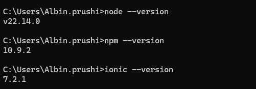
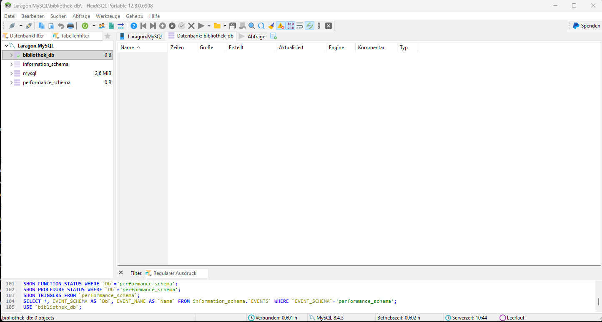

# Lab 1 – Installation und allgemeine Fragen

## Installierte Versionen

## Leere Datenbank

Die leere Datenbank `bibliothek_db` wurde mit Laragon erstellt.

## Was ist der Unterschied zwischen Capacitor und Cordova?

Capacitor und Cordova verpacken eine Web-App als App für Android oder iOS. Capacitor ist neuer und wird von Ionic empfohlen, weil es moderner aufgebaut ist und besser mit aktuellen Web-Technologien funktioniert. Cordova ist älter, wird aber noch bei bestehenden Projekten verwendet.

## Was macht ein ORM wie Sequelize, und wofür braucht man zusätzlich die sequelize-cli?

Sequelize ist ein ORM, das JavaScript-Objekte mit Tabellen einer Datenbank verbindet. Dadurch kann man Daten mit JavaScript bearbeiten, ohne jedes SQL-Statement selbst schreiben zu müssen. Die sequelize-cli hilft beim Erstellen und Ausführen von Models und Migrationen.

## Was unterscheidet `npm install` von `npx` beim Ausführen eines Pakets?

`npm install` installiert ein Paket dauerhaft im Projekt oder global auf dem Computer. Mit `npx` kann man ein Paket direkt ausführen, ohne es vorher global installieren zu müssen. Das ist praktisch für Befehle, die man nur selten braucht.

## Was ist REST, und warum passt das Konzept zu einer Client-Server-Architektur wie Ionic-App und Node-Backend?

REST ist ein Konzept für Schnittstellen zwischen Client und Server über HTTP. Mit Methoden wie `GET`, `POST`, `PUT` und `DELETE` können Daten gelesen, erstellt, geändert oder gelöscht werden. Die Ionic-App sendet Anfragen an das Node-Backend, welches die Daten verarbeitet und meist als JSON zurückgibt.
