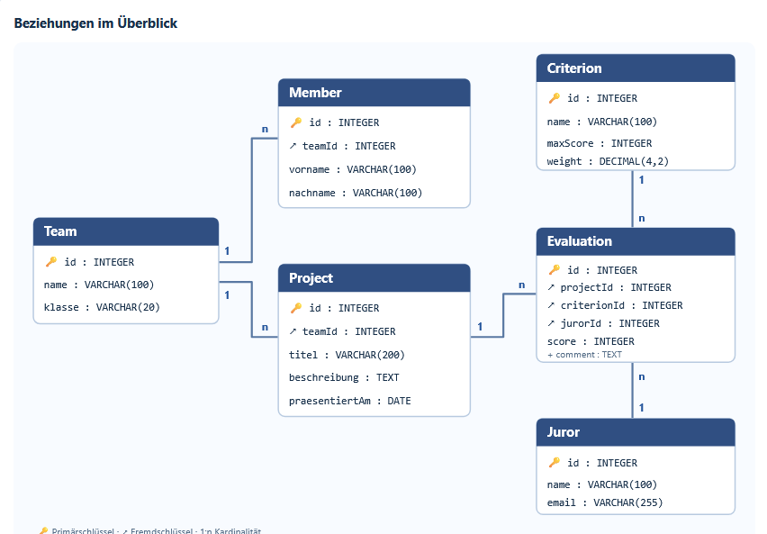
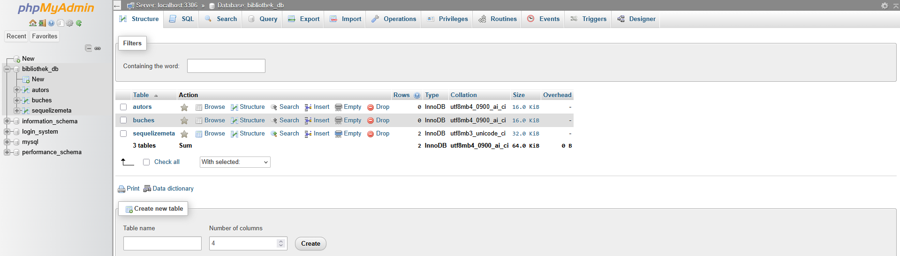

# Lab 2 – Datenbank-Grundlagen und Sequelize-CLI

## Ziel

In diesem Arbeitsauftrag wurde die bestehende Datenbank `bibliothek_db` um die Tabellen für Autoren und Bücher erweitert. Dazu wurden mit der Sequelize-CLI Models und Migrationen erstellt.

## Model, Migration und Tabelle

Ein **Model** beschreibt eine Datenbanktabelle im JavaScript-Code. Eine **Migration** enthält die Änderungen an der Datenbankstruktur. Erst wenn die Migration ausgeführt wird, entsteht die tatsächliche **Tabelle** in MySQL.

## Projekt vorbereiten

Im bereits vorhandenen Projektordner wurden die benötigten Pakete installiert:

```bash
npm install express cors morgan sequelize cookie-parser mysql2
npm install --save-dev sequelize-cli
```

Danach wurde die Sequelize-CLI initialisiert:

```bash
npx sequelize-cli init
```

Dabei wurden die Ordner `config`, `models`, `migrations` und `seeders` erstellt. In `config/config.json` wurden für `development` die lokalen Zugangsdaten zur bereits in Lab 1 angelegten Datenbank `bibliothek_db` eingetragen.

## Model Autor

Das Model `Autor` und die zugehörige Migration wurden so erzeugt:

```bash
npx sequelize-cli model:generate --name Autor --attributes name:string,geburtsjahr:integer
npx sequelize-cli db:migrate
```

Die Tabelle `Autors` enthält die Spalten `id`, `name`, `geburtsjahr`, `createdAt` und `updatedAt`.

## Model Buch

Danach wurden das Model `Buch` und seine Migration angelegt:

```bash
npx sequelize-cli model:generate --name Buch --attributes titel:string,isbn:string,erscheinungsjahr:integer,autorId:integer
npx sequelize-cli db:migrate
```

Die Tabelle `Buchs` enthält die Spalten `id`, `titel`, `isbn`, `erscheinungsjahr`, `autorId`, `createdAt` und `updatedAt`.

## Beziehung zwischen Autor und Buch

Ein Autor kann mehrere Bücher haben (**1:n**). Die Spalte `autorId` im Buch ist für die Zuordnung vorgesehen. Der Befehl `model:generate` erstellt damit zunächst nur eine `INTEGER`-Spalte: Ein echter Fremdschlüssel-Constraint und die Sequelize-Assoziation müssen bei Bedarf gesondert definiert werden.

## Kontrolle in der Datenbank

Nach dem Ausführen der Migrationen wurden in der Datenbank `bibliothek_db` die Tabellen `Autors` und `Buchs` kontrolliert.


## ER-Diagramm der Bewertungsapp

Das separat erstellte ER-Diagramm der Bewertungsapp zeigt die Entitäten `Team`, `Member`, `Project`, `Criterion`, `Juror` und `Evaluation` sowie ihre Beziehungen.



## Ergebnis

Für `Autor` und `Buch` liegen jeweils ein Model und eine Migration vor. Die Datenbanktabellen werden durch `npx sequelize-cli db:migrate` erstellt beziehungsweise aktualisiert. Die Verbindung der Models im JavaScript-Code folgt in der nächsten Einheit.
