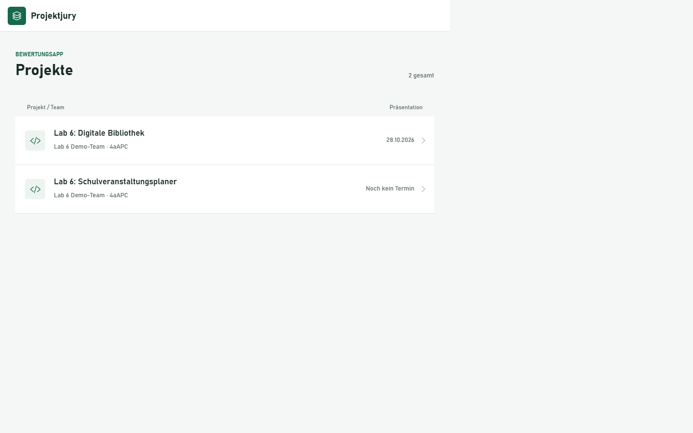

# Lab 6 - Ionic-Frontend fuer die Bewertungsapp

## Ziel

Ein eigenes Ionic-Angular-Frontend zeigt Projekte inklusive Team an. Eine Detailansicht laedt die bisherigen Bewertungen mit Kriterien, Jury, Punkten und Kommentaren. Die Daten stammen aus der Express-API und der MySQL-Datenbank, nicht aus fest eingebauten Frontend-Daten.

## Projekt anlegen

Das Projekt wurde mit dem leeren Ionic-Layout `blank` im Unterordner `bewertungs-app` angelegt:

```bash
ionic start bewertungs-app blank --type=angular
```

Die Bibliotheksbeispiele wurden fuer die eigene Bewertungsapp auf `Project`, `Team` und `Evaluation` uebertragen. Statt Buchliste und Buchdetail gibt es eine Projektliste und Projektdetails. Die App verwendet Angular-Module, Lazy Loading und die aktuelle Angular-Syntax `@if`, `@for` und `inject()`.

## Voraussetzungen

- Laragon mit laufendem MySQL und der Datenbank aus [config/config.json](../config/config.json).
- Angewendete Sequelize-Migrationen aus den vorigen Labs.
- Fuer das aktuelle Frontend eine kompatible Node-Version: beispielsweise Node 24 ab 24.15.0. Node 22.14 reicht fuer das generierte Angular-Projekt nicht aus.
- Backend-Port 3000 und Frontend-Port 8100. CORS erlaubt lokal auch Frontend-Port 8101.

Die folgenden Befehle mit `npx --package=node@24` laden eine kompatible Laufzeit, ohne die globale Node-Installation zu ersetzen.

## Backend

[routes/projects.js](../routes/projects.js) stellt zwei Endpunkte bereit:

| Methode | Pfad | Antwort |
|---|---|---|
| GET | `/projects` | Projektliste mit zugehoerigem `Team` |
| GET | `/projects/:id` | Projekt mit `Team` und `Evaluations`, jeweils inklusive `Criterion` und `Juror` |

Die Detailabfrage verwendet:

```javascript
const project = await Project.findByPk(req.params.id, {
  include: [Team, { model: Evaluation, include: [Criterion, Juror] }]
});
```

Unbekannte Projekte ergeben Status 404. [index.js](../index.js) bindet den Router unter `/projects` ein und erlaubt Browseranfragen von `http://localhost:8100` und `http://localhost:8101` per CORS.

Backend im Repository-Hauptordner starten:

```bash
npm install
npx sequelize-cli db:migrate
npm start
```

## Backend-URL und API-Service

Die Backend-Adresse steht in [environment.ts](../bewertungs-app/src/environments/environment.ts) und [environment.prod.ts](../bewertungs-app/src/environments/environment.prod.ts):

```typescript
export const environment = {
  production: false,
  apiUrl: 'http://localhost:3000'
};
```

Die Produktionsdatei verwendet `production: true`. Die lokale URL ist fuer die Abgabe am Entwicklungsrechner vorgesehen. Fuer ein anderes Deployment muss sie auf die erreichbare Backend-Adresse geaendert werden.

Der vollstaendige Service mit den Interfaces steht in [api.service.ts](../bewertungs-app/src/app/services/api.service.ts). Die beiden Abfragen sind:

```typescript
getProjects(): Observable<Project[]> {
  return this.http.get<Project[]>(`${this.url}/projects`);
}

getProject(id: number): Observable<ProjectDetail> {
  return this.http.get<ProjectDetail>(`${this.url}/projects/${id}`);
}
```

`HttpClientModule` ist in [app.module.ts](../bewertungs-app/src/app/app.module.ts) importiert. Die Typen spiegeln die Sequelize-Antworten wider: `Team`, `Evaluations`, `Criterion` und `Juror` behalten ihre vom Backend gelieferten Namen.

## Die beiden Seiten

Die Projektliste besteht aus [projekt-liste.page.ts](../bewertungs-app/src/app/pages/projekt-liste/projekt-liste.page.ts) und [projekt-liste.page.html](../bewertungs-app/src/app/pages/projekt-liste/projekt-liste.page.html).

- Ruft beim Betreten der Seite `getProjects()` auf.
- Zeigt Titel, Team, Klasse und Praesentationstermin.
- Navigiert beim Anklicken nach `/projects/:id`.
- Behandelt Ladezustand, leere Datenbank und Verbindungsfehler.

Die Detailansicht besteht aus [projekt-detail.page.ts](../bewertungs-app/src/app/pages/projekt-detail/projekt-detail.page.ts) und [projekt-detail.page.html](../bewertungs-app/src/app/pages/projekt-detail/projekt-detail.page.html).

- Liest die ID aus `ActivatedRoute` und prueft, ob sie eine positive ganze Zahl ist.
- Laedt das Projekt ueber `getProject(id)`.
- Zeigt Beschreibung, Team, Klasse und Praesentationstermin.
- Zeigt bestehende Bewertungen inklusive Kriterium, Maximalpunkten, Jury und Kommentar.
- Behandelt fehlende Bewertungen, unbekannte Projekte und Verbindungsfehler.
- Ermoeglicht Zuruecknavigation zur Liste.

Die Routen werden in [app-routing.module.ts](../bewertungs-app/src/app/app-routing.module.ts) per Lazy Loading eingebunden. Die Startseite leitet auf `/projects` weiter. Die Gestaltung liegt in [global.scss](../bewertungs-app/src/global.scss).

## Optionale Demo-Daten

Der Seeder [20261028090000-lab6-demo-projekte.js](../seeders/20261028090000-lab6-demo-projekte.js) legt zwei eindeutig gekennzeichnete Projekte, ein Team, eine Demo-Jury und zwei Kriterien an. Ein Projekt besitzt zwei Bewertungen, das zweite noch keine. Bestehende Datensaetze werden nicht aktualisiert; erneutes Ausfuehren legt dieselben Demo-Datensaetze nicht doppelt an.

Im Repository-Hauptordner:

```bash
npx sequelize-cli db:seed --seed 20261028090000-lab6-demo-projekte.js
```

Die Demo-Daten wurden fuer den lokalen Integrationstest eingefuegt und sind in der laufenden App sichtbar.

## Frontend starten

In einem zweiten Terminal:

```bash
cd bewertungs-app
npm install
npx --yes --package=node@24 --package=@ionic/cli -c "ionic serve --no-open --host=localhost --port=8100"
```

Bei einer bereits kompatiblen globalen Node-Installation und installierter Ionic CLI genuegt stattdessen:

```bash
ionic serve --no-open --host=localhost --port=8100
```

Frontend: `http://localhost:8100`. Backend: `http://localhost:3000/projects`. Falls Port 8100 belegt ist, kann `--port=8101` verwendet werden.

## Pruefung

Im Frontend-Ordner:

```bash
npx --yes --package=node@24 -c "npm run build"
npx --yes --package=node@24 -c "npm test -- --watch=false"
npx --yes --package=node@24 -c "npm run lint"
```

Die Service-Tests stehen in [api.service.spec.ts](../bewertungs-app/src/app/services/api.service.spec.ts) und pruefen Listenabruf, Detailabruf und Weitergabe einer 404-Antwort. Die echten Backend-Endpunkte wurden zusaetzlich gegen MySQL auf Teamzuordnung, Kriterien, Jury, Bewertungen und CORS geprueft.

Im Browser pruefen: Projektliste laden, Projekt oeffnen, Bewertungen kontrollieren, zurueck navigieren und das zweite Projekt ohne Bewertungen oeffnen.

## Screenshot



## Abgabe

Abzugeben sind die laufende App, der vollstaendige API-Service und beide Seiten. Commit und Tag werden bewusst nicht automatisch erstellt. Nach Kontrolle der Aenderungen koennen im Repository-Hauptordner folgende Befehle verwendet werden:

```bash
git add README.md docs/lab6.md index.js routes/projects.js seeders/20261028090000-lab6-demo-projekte.js bewertungs-app .gitignore
git commit -m "Lab 6: Ionic-Frontend fuer die Bewertungsapp"
git tag lab6
git push
git push origin lab6
```

Den Link auf den Tag `lab6` im eigenen GitHub-Repository im Moodle-Aufgaben-Feld fuer Einheit 6 einreichen. Bei einem bereits vorhandenen Tag nicht ohne Pruefung ueberschreiben.
